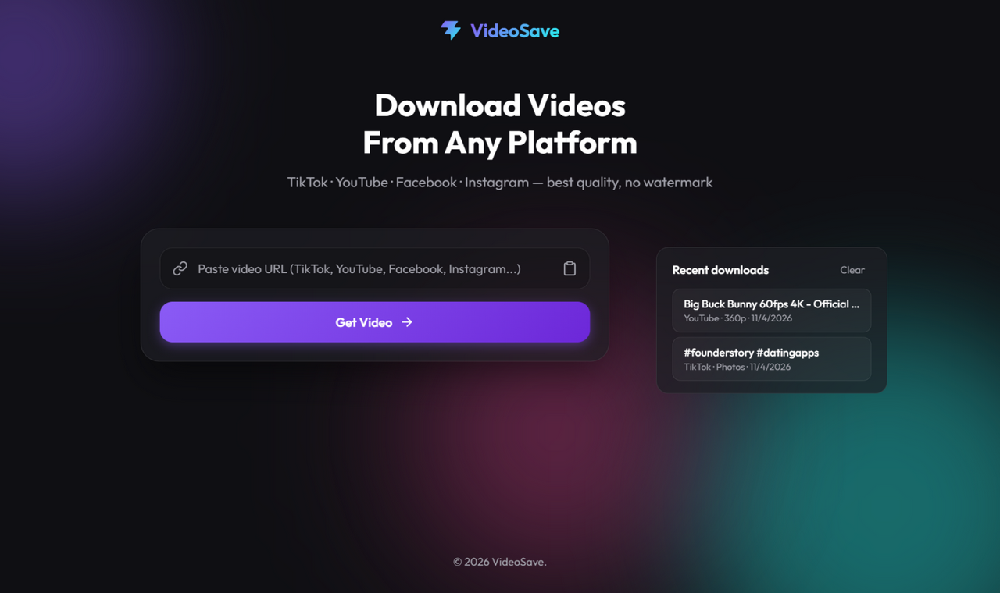
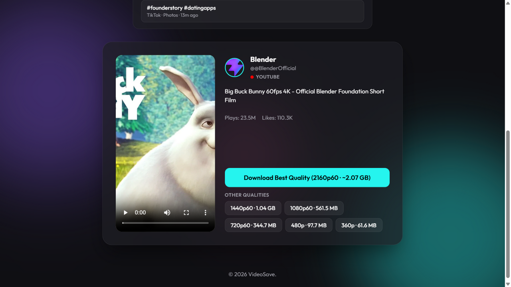
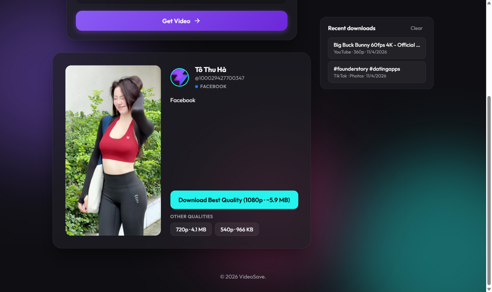

# 🎬 VideoSave

A beautiful multi-platform video downloader — paste a link, preview instantly, save in the **best available quality** (up to 4K).

**Supported platforms:** TikTok · Douyin · YouTube · Facebook · Instagram



## ✨ Features

- **One input, five platforms** — the URL is auto-detected, no manual switching
- **Douyin without sign-in** — signed public metadata requests, short-link resolution, HD no-watermark downloads
- **Best quality by default** — yt-dlp + ffmpeg merge separate video/audio streams into a clean MP4 (H.264/AAC preferred), unlocking 1080p/4K that browser-only tools can't reach
- **Quality picker** — every available resolution with estimated file size, right on the result card
- **Instant preview** — play the video in-page before downloading
- **No watermark** — TikTok downloads come watermark-free
- **One-click launcher** — double-click `start.bat` and everything runs
- **Facebook login support** — videos that require login are downloaded using your own session

## 📸 Screenshots

### YouTube — 4K quality picker with file sizes



### Facebook — reels that require login still work



## 🚀 Getting started

### One click (Windows)

Double-click **`start.bat`** — dependencies install on first run, the API + web server start, and your browser opens automatically at **http://localhost:5180**.

Close the console window to stop the app.

### From the terminal

```bash
npm install
npm start        # starts API (3001) + web UI (5180)
```

`npm install` automatically downloads the yt-dlp and ffmpeg binaries — **no Python or system packages needed**.

## 🔑 Facebook login cookies (one-time setup)

Facebook blocks many videos from anonymous visitors. To download them:

1. Log into **facebook.com** in your browser
2. Double-click **`refresh-fb-cookies.bat`** and accept the Windows admin prompt
3. Restart the app

Sessions last a few months — if Facebook videos start failing again, run the script once more.

> The cookie profile lives in `server/cookies/` and is **git-ignored**. Never commit or share it — it contains your Facebook session.

## 🏗️ How it works

| Platform | Engine | Notes |
| --- | --- | --- |
| TikTok | tikwm.com API | HD no-watermark + watermarked options |
| Douyin | Signed public web API | Short links, HD no-watermark + watermarked options, no sign-in |
| YouTube | yt-dlp + ffmpeg | Up to 4K, H.264/AAC merged MP4 |
| Facebook | yt-dlp + ffmpeg | Share links (`/share/v/`, `/share/r/`) auto-normalized; login cookies supported |
| Instagram | yt-dlp + ffmpeg | Public posts, reels |

```
URL ──▶ detectPlatform()
         ├─ tiktok ──────────────▶ tikwm.com API ──▶ direct stream proxy
         ├─ douyin ──────────────▶ signed web API ──▶ direct stream proxy
         └─ youtube / facebook /
            instagram ───────────▶ yt-dlp -J ──▶ quality list
                                 └▶ yt-dlp -f bestvideo+bestaudio
                                    + ffmpeg merge ──▶ MP4
```

**API endpoints**

| Endpoint | Purpose |
| --- | --- |
| `POST /api/video-info` | Platform detection + normalized metadata + qualities |
| `GET /api/download` | Direct media proxy (TikTok / Douyin) |
| `GET /api/download-ytdlp` | Server-side download + merge to MP4 |
| `GET /api/preview` | Media proxy for the in-page player |

## ⚠️ Known limitations

- Age-restricted / bot-checked YouTube videos require sign-in (clear error is shown)
- Only content your account can see is downloadable
- Facebook changes its page layout often — if downloads break, update yt-dlp: `node_modules/youtube-dl-exec/bin/yt-dlp.exe -U`

## 🛠️ Tech stack

Vite · TypeScript · Express · yt-dlp · ffmpeg — zero runtime database, everything streams.

## 📄 License

MIT
